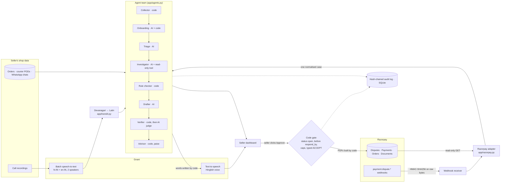

# DisputeDesk for Razorpay: architecture

DisputeDesk defends a small Indian seller against chargebacks on Razorpay. The design rule is simple:
**AI reads and writes; code decides money; a human approves every write to Razorpay.**

## 1. The whole system



## 2. Who may do what

| Step | Who | Can it move money? | Where it's enforced |
|---|---|---|---|
| Read the dispute, payment, order | Code | No | `app/razorpay.py` read calls |
| Gather evidence E1..En | Code | No | `evidence.gather` |
| Summarise, draft claims, judge claims, flag manipulation | AI | No | `app/agents.py`; the AI's only tool is a read-only customer-history lookup |
| Strike unproven claims | Code first, then AI | No | `core.check_claim`, `agents.verify_claims` |
| Decide contest / concede part / review, and the amount | Code | It sets the number | `core.recommend` (integer paise, seller caps) |
| Write the reply and the PDFs | Code | No | `agents.analyze` (fixed opening/closing + verified claims), `core.contest_plan`, `app/pdf.py` |
| Upload documents and contest | **Seller's click** | Yes | `Service.approve` re-reads the dispute and checks `core.allowed_actions` first |
| Accept the dispute | **Seller types ACCEPT** | Yes (irreversible) | `Service.approve` |

There is no code path from an AI output to a Razorpay write. The AI can't call `contest` or `accept`: those functions
are never given to it as tools, and `Service.approve` runs only from a POST behind a cross-site check (and a password once `ADMIN_PASSWORD` is set).

## 3. One dispute, start to finish

```mermaid
sequenceDiagram
    participant R as Razorpay
    participant D as DisputeDesk
    participant A as AI (Nemotron)
    participant S as Seller
    R->>D: payment.dispute.created (signed)
    D->>D: verify HMAC on raw body, dedupe by event id
    D->>R: GET dispute, payment, order
    D->>D: normalise, gather evidence E1..En (shop, courier, chats, calls)
    D->>A: triage, investigate, draft claims citing E-ids
    A-->>D: claims
    D->>D: code fact-check (dates, ₹, AWB, quotes, citations)
    D->>A: judge the survivors (copy the first five words of each)
    A-->>D: verdicts, aligned to claims by code
    D->>D: decision and amount in paise; checklist; cost of each choice
    D->>S: case page, voice brief in Hinglish (Gnani)
    S->>D: Approve & contest
    D->>R: GET dispute again (still open? before respond_by?)
    D->>R: POST /v1/documents (one PDF per evidence field)
    D->>R: PATCH /v1/disputes/:id/contest (amount, summary, document ids)
    R-->>D: under_review
    R->>D: payment.dispute.won / lost (signed)
```

## 4. Where things live

| Layer | Files | Notes |
|---|---|---|
| Web | `app/main.py`, `app/templates/`, `app/static/agents.js` | Starlette, server-rendered pages, live agent panel polls `/agents/live` |
| Glue | `app/service.py` | sync, webhooks, analysis runs, approvals, call queue (one worker, because Gnani allows one job at a time), voice briefs |
| Gateway | `app/razorpay.py`, `app/demo.py` | Only these know Razorpay's JSON. Demo mode serves the same shapes offline |
| Rules | `app/core.py`, `policy/dispute_rules.md` | deterministic; unit-tested |
| AI | `app/agents.py`, `app/llm.py` | any OpenAI-compatible model; structured output validated with pydantic; offline fake brain for demos and tests |
| Speech | `app/llm.py` (Gnani), `app/translit.py` | batch STT with two speakers; code converts Devanagari to Latin letters |
| Storage | `app/db.py` | SQLite: disputes, evidence, analyses, calls, documents, rules, hash-chained audit |
| Evaluation | `evals/`, `scripts/risk_eval.py`, `scripts/eval.py`, `scripts/attack_eval.py`, `scripts/gnani_check.py` | precision/recall on a frozen held-out set; end-to-end; attacks; live Gnani round trip |

## 5. Failure handling

- **AI step fails or returns bad JSON:** retried, then the step falls back to code (for example, the judge failing keeps
  only code-verified claims) and the seller sees a warning.
- **Judge mixes up claim numbers:** a verdict counts only for the claim whose first words it copied; anything unmatched is judged again alone.
- **Razorpay refuses an action:** the full error goes to the audit log, the seller sees the reason, and the case stays a draft to retry.
- **A document upload fails:** nothing is contested, because uploads happen before the contest call.
- **Webhook missed or out of order:** the app always re-reads the dispute from Razorpay, and a watcher re-checks open disputes every few minutes.
- **Deadline:** contest and accept are refused by code after `respond_by`, the same as Razorpay does.

## 6. Defence only

DisputeDesk answers chargebacks with the seller's own records. It never contacts customers, never raises disputes,
never touches anyone else's account, and the AI has no tool that writes anywhere. Customer text, including anything
that tries to instruct the AI, is treated as data.
